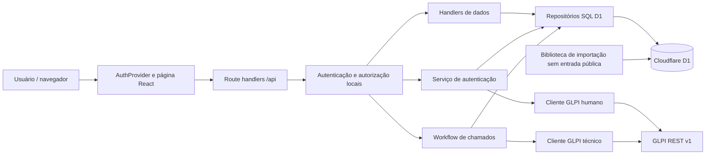

# Auditoria de arquitetura

## Arquitetura atual e fronteiras

O runtime é Worker via Vinext/Vite, com API no mesmo projeto. Não há servidor backend separado nem camada cliente que consulte GLPI diretamente. O esquema é declarado com Drizzle, mas as operações de negócio usam predominantemente SQL preparado D1. `db/index.ts` oferece Drizzle; não foram encontrados consumidores de `getDb()` no código de negócio atual. Isso é uma distinção de implementação, não razão para trocar automaticamente a persistência.

## Aspectos a preservar

- Separação entre cliente GLPI, normalização de erros, workflow e repositório.
- Injeção de `fetch`, repositório e relógio/fábrica de token em serviços: permite testes sem infraestrutura externa.
- Autorização aplicada no servidor, além da visibilidade de botões no frontend.
- Atualizações condicionadas a `revision`, com 409 para versão antiga.
- Idempotência durável de chamados e estado explícito de incerteza.
- SQL com parâmetros vinculados; sem concatenação de valores de usuário nas consultas revisadas.
- Infraestrutura de importação com origem única e batch transacional.

## Diagnóstico por preocupação

| ID | Classe | Evidência | Consequência / direção |
|---|---|---|---|
| A01 | C | `app/page.tsx` reúne 514 linhas, oito áreas, requisições, transformação de payload, tema, modal e formulários | Alterar um cadastro exige navegar por responsabilidades distintas; extrair gradualmente shell, consulta, detalhes e formulários |
| A02 | C | `RecordKind` na página duplica `db/data-types.ts`; labels/campos/regras existem na página, API e importação | Novos campos exigem mudanças coordenadas; criar contrato compartilhado de domínio, sem importar código de runtime Cloudflare no cliente |
| A03 | C | `details_json` e `RecordDetails` com assinatura `[key: string]` | Tipos permitem combinações que a API rejeita; evoluir para união discriminada e parse explícito na leitura |
| A04 | C | `db/storage.ts:24` tolera JSON inválido e devolve `{}` sem diagnóstico | Corrupção semântica pode aparecer como campo vazio; registrar diagnóstico seguro e prever modo de reparação autorizado |
| A05 | C | `db/persistence.ts:4` e migrations mantêm duas definições de schema | Startup só garante duas tabelas e índices, não toda a aplicação; substituir DDL em requisição por verificação de versão/saúde em evolução futura |
| A06 | C | `createDataHandlers.POST/PUT` gravam e depois retornam `storage.readAll()` | Resposta 500 pode ocorrer após gravação; separar confirmação de escrita da consulta completa e idempotência de criação |
| A07 | R | `readAll()` sem paginação e filtro client-side com `categories.find` por registro | Custo cresce com a base; medir payload/latência antes de projetar busca paginada no servidor |
| A08 | C | `getSessionUser` faz UPDATE de `last_seen_at` a cada autenticação | GETs autenticados escrevem, dificultando observabilidade e auditoria somente leitura; definir cadência de atualização |
| A09 | C | `getAuthService()` constrói config do cliente GLPI mesmo para `currentUser` e logout | Configuração inválida do provedor impede validar/revogar sessões locais; separar dependências por operação |
| A10 | R | `completeImportBatch` lê contadores e depois decide status fora da mesma atualização | Concorrência com rejeição pode classificar conclusão incorretamente; decidir status com a fotografia transacional final |
| A11 | C | Históricos operacionais sem eventos imutáveis por alteração | Revisão informa concorrência, mas não autoria/conteúdo anterior; planejar auditoria sem armazenar segredos |
| A12 | C | `db/env.d.ts` omite `GLPI_TICKET_CREATE_TIMEOUT_MS`, usado pela configuração técnica | Tipagem de bindings não acompanha todos os parâmetros; alinhar contrato de ambiente |

## Acoplamentos importantes

O título deriva de detalhes de VLAN/câmera/ponto, e a API exige igualdade exata. Mudar pontuação, tradução ou composição no frontend pode quebrar gravação. A categoria deve ter escopo idêntico ao tipo de registro, inclusive na persistência. Uma simples reorganização visual de categorias não pode alterar essa regra inadvertidamente.

AuthProvider centraliza 401 e desmonta o conteúdo autenticado, perdendo estado de navegação e rascunhos. A política é segura quanto à sessão expirada, mas a experiência de recuperação precisa ser especificada. A instância `request` é estável; não foi identificada necessidade de trocar toda a solução por uma biblioteca de estado.

Em chamados, a linha local e a operação remota não podem participar da mesma transação. O estado uncertain é essencial. Uma arquitetura futura com fila/outbox pode ajudar reconciliação, mas precisa manter o bloqueio contra novo POST da mesma operação e tratar falha entre criação remota e confirmação local.

## Estratégia de evolução

1. Estabelecer testes de contratos e baseline recuperado antes de mover arquivos.
2. Separar componentes da página mantendo payloads e comportamento.
3. Centralizar tipos e validação de negócio reutilizáveis entre API e importação.
4. Melhorar contratos de escrita, observabilidade e verificação de schema.
5. Introduzir domínios específicos (trechos, equipamentos, parceiros) somente com requisitos aprovados e transição aditiva.
6. Acrescentar paginação/busca e rotas de navegação conforme necessidade medida.

Não há justificativa para trocar React, D1 ou o backend de uma vez. Vinext é versão beta no projeto; isso exige atenção aos avisos, compatibilidade e testes de runtime, mas o build atual passou. Não foi feita comparação externa de suporte, versões ou CVEs.

## Riscos de refatoração

Os maiores contratos são a compatibilidade de JSON legado, revisões otimistas, escopo de categorias, bootstrap único, IDs GLPI, cookie de sessão e chaves de operação. A ordem e os critérios de aceite estão no [plano](08-PLANO-DE-REFORMULACAO.md). Não foram implementadas as mudanças propostas.
